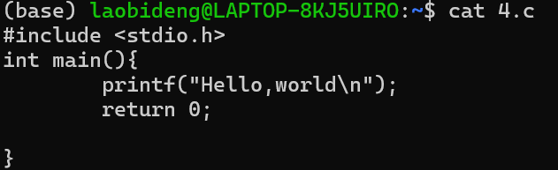
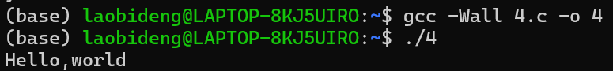
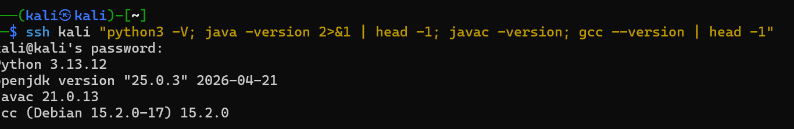

---
title: 红岩作业 1：Linux、环境配置和搭博客
published: 2026-11-02
description: 第一次作业记录：在 Linux 上用 vim 写 C 程序、给 Kali 配好 Python / Java / gcc，以及搭这个博客的过程。
tags: [作业, Linux, 环境配置]
category: 作业
draft: false
---

这次作业三件事：用 vim 写 C 程序、配好虚拟机的开发环境、搭一个个人博客。过程都记在下面。

## 一、在 Linux 上用 vim 写一段 C 语言代码，输出 hello, world

整体流程就四步：先建文件，再编辑，然后看一眼内容，最后编译运行。

1. `touch` 创建
2. `vim` 编辑
3. `cat` 查看



4. 编译并查看



> 编译和查看是 AI 教的。

## 二、给自己的虚拟机配好常用环境（Python、Java、gcc 等）

我的虚拟机是 Kali，环境基本是自带的，所以主要是**确认版本、确认能用**：



查出来的结果：

| 环境 | 版本 |
| :--- | :--- |
| Python | 3.13.12 |
| Java (OpenJDK) | 25.0.3 |
| javac | 21.0.13 |
| gcc | 15.2.0 |

检查的命令是这一串，一条就能全查完：

```bash
ssh kali "python3 -V; java -version 2>&1 | head -1; javac -version; gcc --version | head -1"
```

:::note
`java -version` 的输出是写到标准错误（stderr）的，所以要加 `2>&1` 才能被管道接到，不然 `head` 什么都拿不到。（AI说的)
:::

## 三、搭建一个个人博客网站

博客地址：[laobid.github.io](https://laobid.github.io/)


::github{repo="laobid/laobid.github.io"}

整体思路是「静态博客 + 托管」：

| 环节 | 用什么 |
| :--- | :--- |
| 写文章 | Obsidian 写 Markdown |
| 存放代码 | GitHub 仓库 |
| 自动构建 | GitHub Actions |
| 对外访问 | GitHub Pages |

> 如图，这个其实也是我用 AI 帮忙搭建的。

## 最后

不出意外，这个作业我想发到博客还需要 AI 帮忙。

……结果确实又是 AI 帮忙发的，属于是知行合一了。
